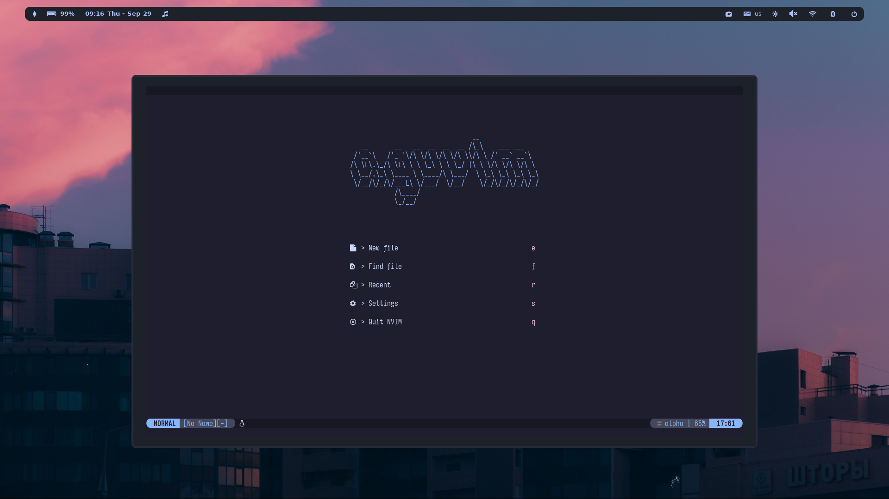

# *Aguvim*
Neovim configuration files.



## Dependencies

Install these executables with the package manager appropriate for your macOS
or Linux system.

### Required

- [Neovim](https://github.com/neovim/neovim) >= v0.12
- [ripgrep](https://github.com/BurntSushi/ripgrep), required by Snacks' text and TODO searches
- [LazyGit](https://github.com/jesseduffield/lazygit)

Install the Tree-sitter CLI in Neovim's isolated Mason directory after the
plugins have been installed:

```vim
:MasonInstall tree-sitter-cli
```

### Optional

- [fd](https://github.com/sharkdp/fd), optional faster file finder for Snacks Picker
- [ImageMagick](https://imagemagick.org/), required by Snacks Image for formats
  other than PNG
- [Delta](https://github.com/dandavison/delta), required for syntax-highlighted
  LazyGit diffs

The debug adapters are also managed by Mason. Install only the ones you use:

```vim
:MasonInstall debugpy cpptools
```
